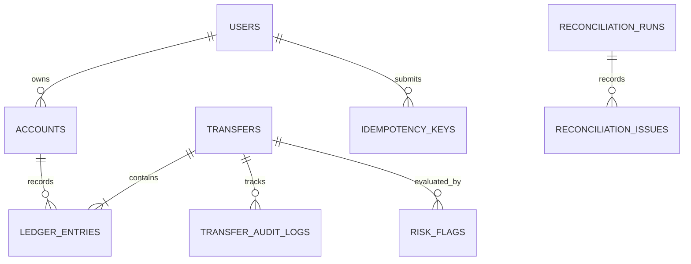

# Schema design

## Noun list and decisions
- **users**: persisted user identity/contact and KYC state.
- **accounts**: one row for either a user's INR wallet or a platform system account (cash-in, cash-out, fee revenue). Keeping them together gives ledger entries one account foreign key.
- **transfers**: business event, type, status, amount and optional reversal link.
- **ledger_entries**: immutable debit/credit facts. Entries are positive paise and direction is stored separately.
- **idempotency_keys**: per-user request key, SHA-256 body hash and saved response.
- **transfer_audit_logs**: append-only status-change history.
- **risk_rules / risk_flags**: configurable thresholds and per-transfer review flags.
- **reconciliation_runs / reconciliation_issues**: durable reports; the job reports discrepancies, it never repairs them.
- **job_locks**: database lock row for singleton scheduled jobs.

## Cardinality
- users 1:N accounts (system accounts have no user).
- transfers 1:N ledger_entries (at least two is an application invariant checked by reconciliation).
- accounts 1:N ledger_entries.
- transfers 1:0..1 reversal transfer via `reversal_of_id` (unique).
- transfers 1:N audit log and risk flags.
- reconciliation_runs 1:N issues.
- users 1:N idempotency keys, with unique `(user_id, idem_key)`.

## Balance decision
We store `accounts.balance_paise` for fast reads and update it in the same database transaction as ledger entries. This is a cached projection, not the source of truth: immutable ledger entries are the audit trail and reconciliation compares the stored value against the ledger-derived value. A ledger-only design makes every balance read more expensive; storing only balances loses the explainable history.

## Constraints and indexes
Money is integer paise in BIGINT; never FLOAT/DOUBLE. `ledger_entries` are positive and direction is constrained. Wallet balances are constrained non-negative; the service locks account rows before checking funds and writing. Indexes cover account statements, transfer entries and recent transfer lookups. Every index increases write cost, so avoid speculative indexes.

## ER diagram

## Assumptions
- Amounts are INR paise and must be positive.
- The starter API uses `X-User-Id` as a development-only identity header. Replace it with authenticated principal identity before any real deployment.
- System-account initialization must be run before top-up/withdrawal endpoints are used.
- LLM support is deliberately fail-closed and deterministic in this starter; no model receives direct database access and no model-generated SQL is executed.
